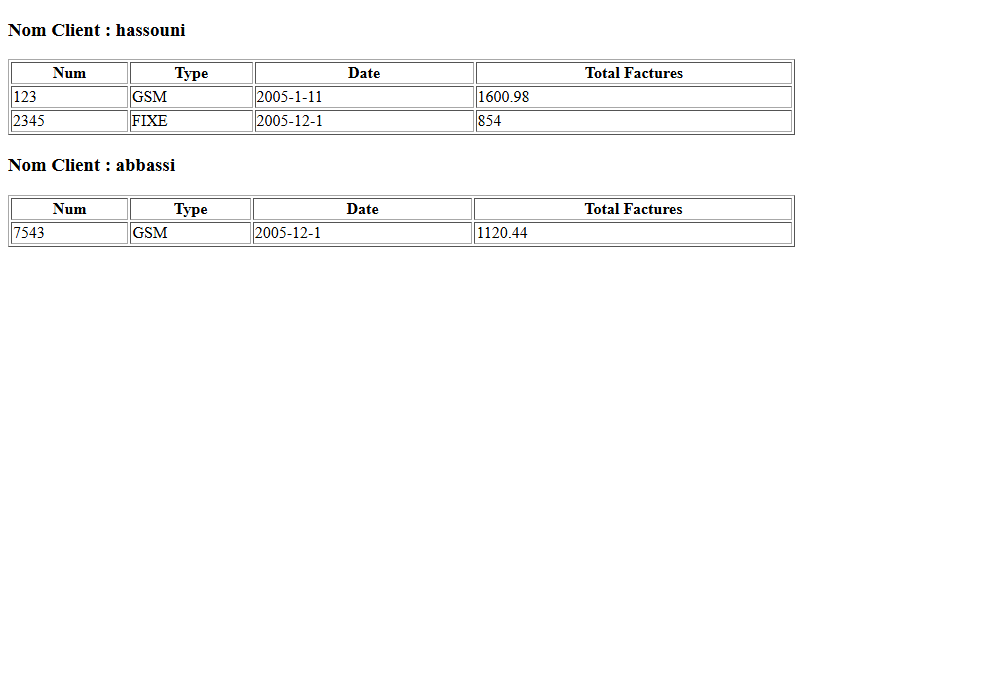

# Partie 2 – Opérateur télécom

Clients, abonnements et factures d'un opérateur : validation par **DTD** et transformation **XSLT** vers HTML.

## Fichiers

| Fichier | Rôle |
|---|---|
| `operateur.dtd` | Structure : `operateur (client+)` → `client (abonnement+)` → `abonnement (facture+)` → `facture` (vide) |
| `operateur.xml` | Données (2 clients, 3 abonnements, 7 factures) |
| `operateur.xsl` | Feuille de style XSLT |
| `operateur.html` | Résultat de la transformation |
| `newProject.xpr` | Projet Oxygen XML |

## DTD

- `client` : `code` (NMTOKEN), `nom`
- `abonnement` : `num` (NMTOKEN), `type` ∈ {`GSM`, `FIXE`} (défaut `FIXE`), `dateAb`
- `facture` : `numFact` (NMTOKEN), `dateFact`, `montant`, `reglee` ∈ {`oui`, `non`} (défaut `non`)

## Transformation

Pour chaque client : un tableau de ses abonnements (numéro, type, date) avec le **total des factures** de chaque abonnement (`sum(facture/@montant)`).

## Résultat

