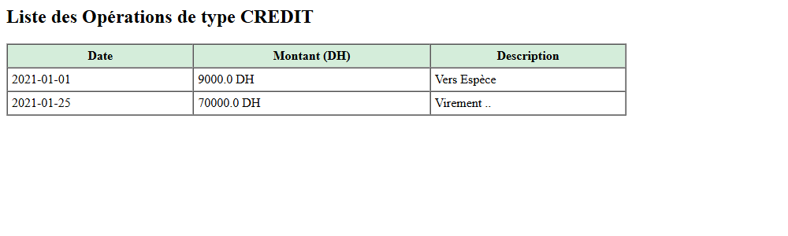

# Partie 3 – Relevé de comptes

Relevé bancaire validé de **deux manières** (DTD et XSD), puis transformé en HTML avec XSLT.

## Fichiers

| Fichier | Rôle |
|---|---|
| `releve.dtd` | Validation par DTD |
| `releve.xml` | XML lié à la DTD (`<!DOCTYPE releve SYSTEM "releve.dtd">`) |
| `releve.xsd` | Validation par XML Schema |
| `Releve_xsd.xml` | XML lié au schéma (`xsi:noNamespaceSchemaLocation="releve.xsd"`) |
| `releve_totaux.xsl` | Liste des opérations + total crédit et total débit |
| `releve_credit.xsl` | Liste des opérations de type CREDIT uniquement |
| `relve_dtd.html` | Résultat obtenu à partir de `releve.xml` (DTD) |
| `relvee.html` | Résultat obtenu à partir de `Releve_xsd.xml` (XSD) |

## Structure

`releve` (attribut `RIB`) contient `dateReleve`, `solde` et `operations` (`dateDebut`, `dateFin`),
qui regroupe des `operation` (`type` ∈ {CREDIT, DEBIT}, `date`, `montant`, `description` optionnelle).

## DTD vs XSD

| | DTD | XSD |
|---|---|---|
| Types | texte (`CDATA`, `#PCDATA`) | `xsd:date`, `xsd:double`, énumération |
| Nombre d'opérations | 0 ou plus (`operation*`) | 0 ou plus (`minOccurs="0"`) |

## Résultats

Les deux pages ont été générées avec `releve_credit.xsl`.

**Méthode DTD** (`relve_dtd.html`)

**Méthode XSD** (`relvee.html`)

