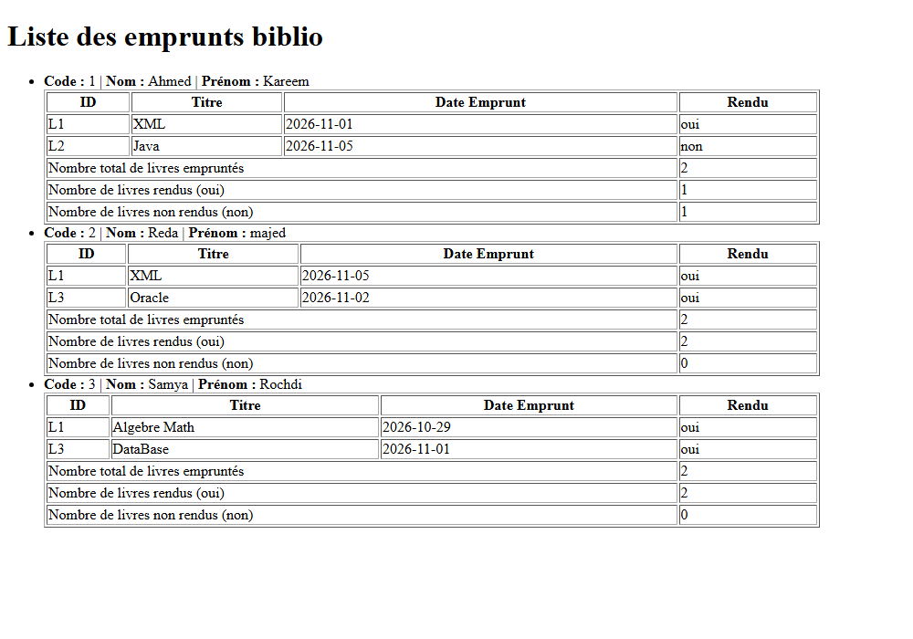

# Partie 1 – Bibliothèque (Biblio)

Gestion des emprunts de livres par des étudiants : validation par **DTD** et transformation **XSLT** vers HTML.

## Fichiers

| Fichier | Rôle |
|---|---|
| `biblio.dtd` | Structure : `biblio (etudiant+)` → `etudiant (livre*)` → `livre` (vide) |
| `biblio.xml` | Données (3 étudiants, leurs livres empruntés) |
| `biblio.xsl` | Feuille de style XSLT |
| `biblio.html` | Résultat de la transformation |

## DTD

- `etudiant` : `code`, `nom`, `prenom`, `age` (tous obligatoires)
- `livre` : `id`, `titre`, `datePret` (obligatoires), `rendu` ∈ {`oui`, `non`} (défaut `non`)

## Transformation

Pour chaque étudiant : un tableau des livres (ID, titre, date d'emprunt, rendu) suivi de trois compteurs :
nombre total de livres, livres rendus (`oui`), livres non rendus (`non`).

## Résultat

