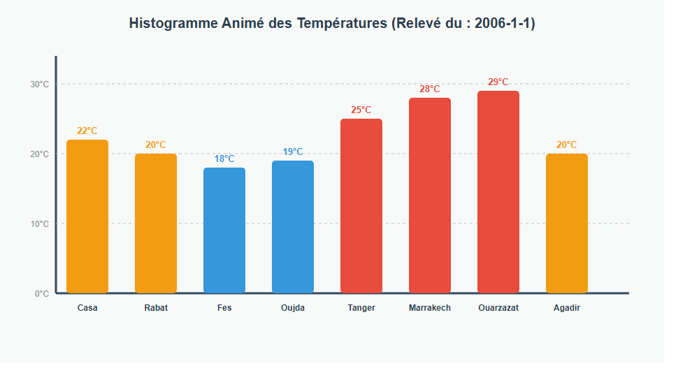
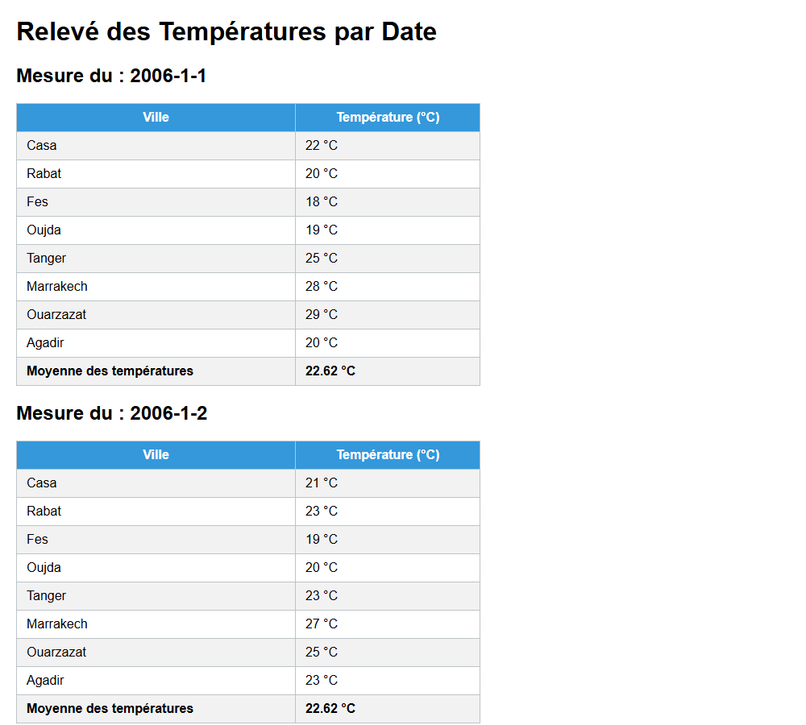
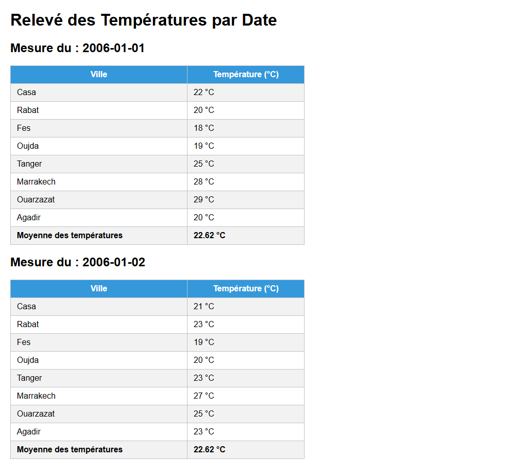

# Partie 4 – Météo (XML + DTD + XSD + XSLT + SVG)

Relevés de températures de villes marocaines, validés par **DTD** et par **XSD**, puis présentés de deux façons :
un **tableau HTML** avec moyenne (`meteo.xsl`) et un **histogramme SVG animé** (`meteo_svg.xsl`).

## Fichiers

| Fichier | Rôle |
|---|---|
| `meteo.xml` | Données liées à la DTD (`<!DOCTYPE meteo SYSTEM "meteo.dtd">`) |
| `meteo.dtd` | Validation par DTD |
| `meteo_xsd.xml` | Mêmes données, liées au schéma (`xsi:noNamespaceSchemaLocation="meteo.xsd"`) |
| `meteo.xsd` | Validation par XML Schema (`temperature` en `xsd:int`, `date` en `xsd:date`) |
| `meteo.xsl` | XSLT → tableaux HTML avec la moyenne par mesure |
| `meteo_svg.xsl` | XSLT → **histogramme SVG animé** |
| `Meteo_DTD.html`, `meteo_XSD.html` | Résultats de `meteo.xsl` |
| `meteo_svg.html` | Résultat de `meteo_svg.xsl` |

## Structure des données

```xml
<meteo>
  <mesure date="2006-1-1">
    <ville nom="Casa" temperature="22"/>
    ...
  </mesure>
  <mesure date="2006-1-2"> ... </mesure>
</meteo>
```

`meteo (mesure+)` → `mesure (ville+)` → `ville` (vide). Attributs : `date` sur `mesure`, `nom` et `temperature` sur `ville`.

---

# L'histogramme SVG

## Résultat



Les barres montent de 0 à leur hauteur finale en 1,2 s, et les valeurs apparaissent en fondu (1,8 s).
Pour revoir l'animation, rechargez la page (F5).

## Comment l'utiliser

**Avec Oxygen XML (recommandé)** : créer un scénario de transformation
1. XML source : **`meteo.xml`** (ou `meteo_xsd.xml`)
2. XSLT : `meteo_svg.xsl`
3. Sortie : `meteo_svg.html`, puis ouvrir ce fichier dans un navigateur.

**En ligne de commande** (avec Saxon, `meteo_svg.xsl` étant en version 3.0) :

```
java -jar saxon-he.jar -s:meteo.xml -xsl:meteo_svg.xsl -o:meteo_svg.html
```

**Pour afficher le résultat** : ouvrir `meteo_svg.html` dans Chrome, Edge ou Firefox. Le SVG est intégré directement dans la page HTML.

## Points importants

### 1. Le XML source doit être `meteo.xml`
Le XSL cherche `meteo/mesure[1]/ville`. Si on le lance sur un autre fichier (par exemple `meteo.xsd`), il ne trouve rien : le graphique reste vide et le titre affiche « Relevé du : ) ».

### 2. Ne rien écrire en dehors des balises
Une ligne de texte placée avant `<svg>` dans le XSL est copiée telle quelle dans le résultat et s'affiche sur la page. L'espace de noms se déclare **dans** la balise : `<svg xmlns="http://www.w3.org/2000/svg" ...>`.

### 3. Le repère du SVG est inversé
L'origine `(0,0)` est **en haut à gauche** et `y` augmente vers le bas. L'axe des X est donc à `y = 420`, et une barre monte en diminuant son `y`.

### 4. Les formules de dessin (par ville)

| Valeur | Formule | Rôle |
|---|---|---|
| `height` | `temperature × 10` | 1 °C = 10 px |
| `x` | `80 + (position − 1) × 98 + 15` | décale chaque barre de 98 px |
| `y` | `420 − height` | place le haut de la barre |
| couleur | ≥ 25 → rouge `#E74C3C`, ≥ 20 → orange `#F39C12`, sinon bleu `#3498DB` | `xsl:choose` |

### 5. Les attributs dynamiques s'écrivent avec `{ }`
`<rect x="{$x}" y="{$y}" height="{$height}" fill="{$color}">` : ce sont des *Attribute Value Templates*. Sans les accolades, XSLT écrit le texte `$x` au lieu de la valeur.

### 6. L'animation est faite en SMIL, sans JavaScript
Deux `<animate>` par barre : `height` (de 0 à la hauteur finale) et `y` (de 420 à la position finale). Avec `fill="freeze"`, la barre reste à sa valeur finale.

### 7. L'échelle est fixe
Les repères 0, 10, 20 et 30 °C sont écrits à la main (lignes à y = 420, 320, 220, 120). Une température supérieure à 34 °C sortirait du cadre. Pour des températures négatives ou plus élevées, il faut recalculer l'échelle.

### 8. Seule la première mesure est tracée
`meteo/mesure[1]` : la mesure du 2006-1-2 n'est pas affichée. Pour tracer une autre date, changer l'indice (`mesure[2]`).

### 9. Saxon ou un processeur XSLT 3.0
Le XSL est en `version="3.0"`. Les navigateurs ne gèrent que XSLT 1.0 : il faut passer par Oxygen ou Saxon pour générer le fichier.

---

# Les tableaux HTML (`meteo.xsl`)

Une table par `mesure`, avec la moyenne calculée par `format-number(avg(ville/@temperature), '0.00')`.
Les deux mesures ont la même moyenne (181 / 8 = 22,625, affiché 22.62), ce n'est pas une erreur.

**Méthode DTD** (`Meteo_DTD.html`, à partir de `meteo.xml`)



**Méthode XSD** (`meteo_XSD.html`, à partir de `meteo_xsd.xml`)



## DTD vs XSD

| | DTD | XSD |
|---|---|---|
| `temperature` | texte (`CDATA`) | entier (`xsd:int`) |
| `date` | texte (`CDATA`), `2006-1-1` accepté | `xsd:date`, format `2006-01-01` obligatoire |
